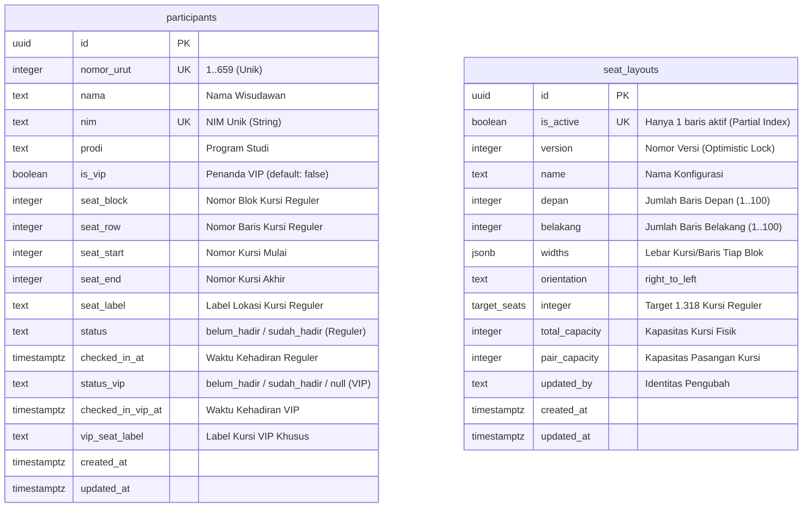

# Dokumentasi Teknis: Kesiapan Database Supabase BDCA Smart Finder (Wisuda)

Dokumen ini menjelaskan hasil pemeriksaan kesiapan database, skema database lengkap, mekanisme keamanan data peserta dan denah, hasil validasi master data Excel 659 wisudawan, serta panduan penerapan berurutan untuk acara wisuda November 2026.

---

## 1. Struktur Database Aktual & Idempotent Migration

Untuk project Supabase baru (**BDCA Smart Finder - Wisuda**), disiapkan berkas SQL lengkap dan terpadu:
👉 [`supabase-complete-setup.sql`](../supabase-complete-setup.sql)

### Ringkasan Entitas & Atribut



---

## 2. Kebijakan Keamanan: Proteksi Mutasi Server-Only, Anti-Mass-UPDATE, & Konsistensi VIP

Aplikasi **tidak memerlukan login atau PIN bagi panitia/pengguna umum**, namun integritas data dan proteksi terhadap penyalahgunaan dilindungi secara berlapis (*defense-in-depth*):

1. **Akses Publik (Anon & Authenticated)**:
   - **Pencarian & Lokasi Kursi**: Publik dapat membaca seluruh data `participants` dan `seat_layouts` melalui policy `SELECT`.
   - **Pencabutan Izin UPDATE Langsung**: Seluruh hak `UPDATE`, `INSERT`, dan `DELETE` pada tabel `participants` dan `seat_layouts` **dicabut sepenuhnya** dari peran `anon` dan `authenticated`:
     ```sql
     REVOKE ALL ON participants FROM anon, authenticated;
     GRANT SELECT ON participants TO anon, authenticated;
     REVOKE ALL ON seat_layouts FROM anon, authenticated;
     GRANT SELECT ON seat_layouts TO anon, authenticated;
     ```
   - **Mitigasi UPDATE Massal**: Karena publik tidak memiliki hak `UPDATE` langsung, penyerang tidak dapat mengirim perintah `PATCH /rest/v1/participants` melalui PostgREST untuk memanipulasi banyak baris sekaligus.

2. **Endpoint Kehadiran Server Terkendali (`/api/attendance`)**:
   - Mutasi kehadiran dialihkan melalui endpoint server:
     - Menerima tepat **1 UUID peserta**, jenis undangan (`reguler` | `vip`), dan tindakan (`hadir` | `batal`).
     - Menolak payload berupa array atau batch (pencegahan mutasi massal).
     - Menerapkan *rate limiting* berbasis IP (maksimal 25 permintaan per 10 detik per perangkat) untuk menangkal bot/flooding.
     - Memvalidasi status VIP (menolak kehadiran VIP jika `is_vip = false`).
     - Menggunakan `SUPABASE_SERVICE_ROLE_KEY` hanya di lingkungan server Next.js (tidak pernah dikirim ke browser).

3. **Fungsi Database `record_attendance` (Jalur Mutasi Terproteksi)**:
   - Dibuat dengan `SECURITY DEFINER` dan kepemilikan terkontrol.
   - Hak `EXECUTE` dicabut dari `public`, `anon`, dan `authenticated`, serta **hanya diberikan kepada `service_role`**:
     ```sql
     REVOKE ALL ON FUNCTION record_attendance(uuid, text, text) FROM public, anon, authenticated;
     GRANT EXECUTE ON FUNCTION record_attendance(uuid, text, text) TO service_role;
     ```
   - Pengguna luar yang memanggil `supabase.rpc('record_attendance', ...)` dengan anon key akan langsung ditolak oleh PostgreSQL (`42501 permission denied`).

4. **Validasi Konsistensi Status VIP (`chk_vip_attendance_consistency`)**:
   - CHECK constraint pada tabel `participants` menjamin peserta `is_vip = false` tidak dapat memiliki nilai pada `status_vip`, `checked_in_vip_at`, atau `vip_seat_label`:
     ```sql
     check (
       (is_vip = false and status_vip is null and checked_in_vip_at is null and vip_seat_label is null)
       or
       (is_vip = true and status_vip in ('belum_hadir', 'sudah_hadir') and (checked_in_vip_at is null or status_vip = 'sudah_hadir'))
     );
     ```

5. **Trigger Transisi VIP Admin (`handle_participant_vip_transition`)**:
   - Ketika admin mengubah peserta menjadi VIP (`is_vip = true`), trigger secara otomatis menginisialisasi `status_vip = 'belum_hadir'` dan `vip_seat_label = 'Area VIP Khusus'` **tanpa merusak** status kehadiran reguler yang sudah ada.
   - Sebaliknya, jika diturunkan dari VIP, kolom VIP dibersihkan menjadi `null` tanpa mengubah kehadiran reguler.

6. **Trigger Pengelolaan `updated_at` Otomatis**:
   - Kolom `updated_at` diperbarui otomatis oleh trigger `update_updated_at_column()` di tingkat database.

---

## 3. Validasi Master Data Excel: 659 Wisudawan & Model Undangan

Berkas master data asli yang diverifikasi adalah [`DAFTAR PANGGIL DAN NOMOR KURSI.xlsx`](../DAFTAR%20PANGGIL%20DAN%20NOMOR%20KURSI.xlsx).

### Aturan Undangan Wisuda November 2026:
- **Wisudawan Reguler (Default)**:
  - 1 Undangan = 2 Orang Tua/Wali.
  - Alokasi: 1 Pasangan Kursi di Area Reguler (D1–D7 dan B1–B7).
- **Wisudawan VIP**:
  - 2 Undangan = 4 Tamu total.
  - Undangan 1: 2 Orang Tua Utama di Area VIP Khusus (`vip_seat_label`).
  - Undangan 2: 2 Tamu Tambahan di Area Reguler (`seat_label`).
  - Kehadiran kedua undangan dicatat secara **independen** (`status` & `checked_in_at` untuk reguler; `status_vip` & `checked_in_vip_at` untuk VIP khusus).

### Hasil Pengujian & Ekstraksi Data:
- **Total Wisudawan**: Tepat **659 orang** (tersebar di 21 sheet program studi).
- **Target Kursi Reguler Orang Tua/Wali**: 659 wisudawan × 2 = **1.318 kursi reguler** (seluruh 659 wisudawan wajib mendapatkan pasangan kursi reguler).
- **Wisudawan Reguler Awal**: 659 orang (seluruh data awal berstatus `is_vip: false`, tanpa asumsi daftar historis).
- **Kapasitas Kursi Khusus VIP**: Dihitung terpisah dari 1.318 kursi reguler ($1.318 + 2N$).
- **Pemeriksaan Duplikasi**: **0 duplikasi** (seluruh 659 NIM unik 100%).
- **Preservasi Karakter NIM**: NIM alfanumerik (misal: `24125002P`, `25251008P`) dan NIM berawalan nol terbaca utuh sebagai string tanpa terpotong.
- **Pemisahan Kursi Mahasiswa**: Kolom kursi mahasiswa (Blok A, B, C, D) dibaca hanya untuk verifikasi baris dan **diabaikan** dari penyimpanan kursi orang tua/wali.

---

## 4. Kebutuhan Environment Variables

Pastikan variabel berikut disiapkan pada berkas `.env.local` (pengembangan) dan pada platform hosting (produksi). Jangan pernah membocorkan nilainya ke repositori publik:

```dotenv
# Kredensial Supabase Baru (BDCA Smart Finder)
NEXT_PUBLIC_SUPABASE_URL=https://<project-ref>.supabase.co
NEXT_PUBLIC_SUPABASE_PUBLISHABLE_KEY=eyJhbGci...

# Secret Key Server (Hanya di server/backend, jangan ada awalan NEXT_PUBLIC_)
SUPABASE_SERVICE_ROLE_KEY=eyJhbGci...

# Password Login Admin Pengaturan Denah (Logo Toga)
ADMIN_PASSWORD=PasswordAdminAcaraWisuda
```

---

## 5. Langkah Penerapan Database yang Aman dan Berurutan

Ikuti 4 langkah berurutan ini di Supabase Dashboard **BDCA Smart Finder (Wisuda)**:

### Langkah 1: Eksekusi Migration SQL
1. Buka dashboard proyek Supabase **BDCA Smart Finder (Wisuda)**.
2. Masuk ke menu **SQL Editor** pada navigasi sisi kiri.
3. Buat query baru dan tempel seluruh isi berkas [`supabase-complete-setup.sql`](../supabase-complete-setup.sql).
4. Klik tombol **Run**.
5. Verifikasi bahwa tabel `participants` dan `seat_layouts` telah dibuat dengan RLS dan trigger aktif.

### Langkah 2: Audit Koneksi dari Komputer/Server
Jalankan script audit untuk memastikan aplikasi menunjuk ke project yang benar:
```bash
npm run audit:supabase
```
Pastikan output menampilkan nama host project baru dan status hak akses `BERHASIL`.

### Langkah 3: Impor Data 659 Wisudawan
1. Jalankan dry-run untuk memastikan data siap:
   ```bash
   npm run import:dry
   ```
2. Jalankan impor penuh ke database Supabase:
   ```bash
   npm run import:excel
   ```
   *Catatan: Script ini menggunakan upsert non-destruktif. Jika dijalankan ulang di kemudian hari, status kehadiran yang sudah tercatat tidak akan terhapus.*

### Langkah 4: Verifikasi Denah & Realtime di Browser
1. Buka halaman utama aplikasi `/`.
2. Login admin via logo toga di kanan atas.
3. Buka **Pengaturan denah**, pastikan kapasitas 18 baris depan / 8 baris belakang menghasilkan 1.352 kursi (676 pasangan) yang mencukupi seluruh 659 wisudawan.
4. Buka tab atau ponsel lain, cari peserta dan tandai kehadiran: pastikan status kehadiran tersinkronisasi secara instan tanpa perlu login. Jika peserta berstatus VIP, verifikasi bahwa tiket VIP Khusus dan tiket Reguler dapat ditandai secara terpisah.

---

## 6. Verifikasi Pengujian & Batasan Pengujian Lokal (Transparansi)

Seluruh komponen keamanan telah diuji secara otomatis melalui perintah pengujian:

```bash
# 1. Pengujian engine PostgreSQL riil (WASM PostgreSQL 16)
npm run test:security:postgres

# 2. Pengujian endpoint kehadiran /api/attendance & rate limiting
npm run test:api:attendance

# 3. Pengujian simulasi keamanan peserta
npm run test:security

# 4. Pengujian denah kursi & kapasitas 659 wisudawan
npm run test:seats
npm run test:layout

# 5. Pengujian sesi admin & validasi Excel
npm run test:admin
npm run test:excel
npm run import:dry
```

### Batasan Pengujian PostgreSQL WASM vs Lingkungan Supabase Sebenarnya:
> [!NOTE]
> Pengujian `npm run test:security:postgres` menggunakan engine C PostgreSQL 16 asli yang dikompilasi ke WebAssembly via `@electric-sql/pglite`.
> 
> **Yang Divalidasi Secara Penuh oleh Pengujian Ini:**
> - Eksekusi skrip `supabase-complete-setup.sql` dari awal hingga akhir.
> - Mekanisme `REVOKE` dan `GRANT` pada tabel dan fungsi.
> - Pemblokiran `UPDATE` langsung dan RPC oleh peran `anon` dan `authenticated`.
> - Keberhasilan mutasi oleh peran `service_role`.
> - Constraint `chk_vip_attendance_consistency` dan trigger otomatis transisi status VIP.
> - Preservasi status kehadiran pada skenario *upsert* berulang.
> 
> **Batasan Pengujian Lokal (Yang Perlu Diverifikasi Saat Deployment Remote):**
> 1. **Lapisan HTTP PostgREST**: Pengujian lokal mengeksekusi perintah SQL secara langsung pada engine PostgreSQL, bukan melalui gateway HTTP PostgREST Supabase.
> 2. **Supabase Realtime Daemon**: Pengujian lokal memverifikasi publikasi `supabase_realtime` terdaftar di pg_catalog, namun koneksi WebSocket realtime aktual antara server Supabase dan browser memerlukan proyek Supabase aktif.
> 3. **Latensi Jaringan & Edge Serverless**: Rate limiting diuji secara in-memory lokal; pada deployment serverless dengan banyak edge instances, konfigurasi Redis eksternal (Upstash) dapat ditambahkan melalui environment variables jika diinginkan.
